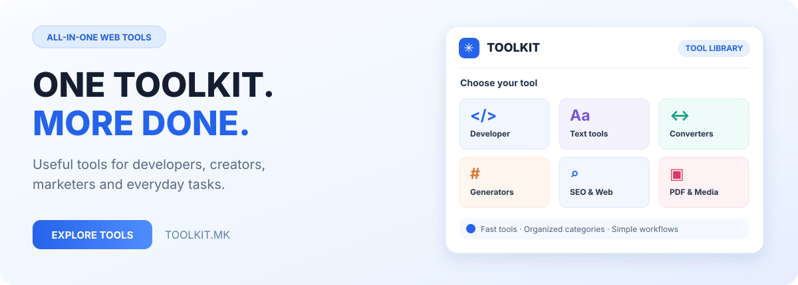

# Toolkit

[Македонски](README.mk.md) · [English](README.md) · [Shqip](README.sq.md) · [Türkçe](README.tr.md)

**Görev için doğru araç, tek yerde.**

**LIVE**

## Görev için doğru araç

**PROCESS IN** ürünü **Toolkit.mk** geliştirici, tasarımcı, pazarlamacı, üretici ve günlük kullanıcılar için araç platformudur. Aranabilir koleksiyon metin, kod, SEO, güvenlik, dosya ve verimlilik işlerini kapsar.

## Alanlar

| Alan | Kullanım |
|---|---|
| **Geliştirme ve kodlama** | Yardımcılar, doğrulayıcılar, kodlama/çözme ve hızlandırıcılar. |
| **SEO ve pazarlama** | Metadata, web optimizasyonu ve içerik. |
| **Metin** | İşleme, biçimlendirme, sayım ve yazı yardımı. |
| **Dönüştürücü ve hesaplayıcı** | Dönüşüm ve verimlilik işlemleri. |
| **Güvenlik ve ağ** | Pratik kontrol ve teşhis. |
| **Üreticiler** | Site, iletişim ve dijital işler için çıktı. |
| **Görsel ve tasarım** | Üretici ve ekip araçları. |
| **PDF ve belge** | Belge yardımcıları. |
| **Sosyal medya** | Paylaşım, bağlantı ve platform görevleri. |
| **Premium ve eklenti** | Mevcutsa Instagram dahil ek özellikler. |

## Premium

Mevcut İngilizce sunum **€49/yıl** listeler; eklentiler ayrıdır. Standart ücretsiz kitaplık abonelik istemez. Premium özel katalog ve hesap özelliklerini açar; deneme ve güncel koşullar ödeme sırasında doğrulanır.

| Araç | Kullanım |
|---|---|
| Website Inspector | Açıklanabilir site denetimi ve puan. |
| AEO Checker | Yanıt motoru hazırlığı. |
| Website Threat Scanner | Web güvenliği ve phishing sinyalleri. |
| SEO Preview Tool | Google'da olası görünüm. |
| Broken Link Checker | Bozuk bağlantılar. |
| Page Indexability Checker | İndekslenebilirlik sinyalleri. |
| Sitemap Validator / Robots Tester | XML sitemap ve robots kuralları. |
| Canonical / Hreflang / Redirect | Teknik SEO kontrolü. |
| Email DNS Checker | MX, SPF, DKIM ve DMARC. |
| Keyword Density / Readability | İçerik özellikleri. |
| Image Compressor / Placeholder Generator | Görsel işleri. |
| Webhook Tester / PDF Editor / Translation Manager | Geliştirici ve belge araçları. |

Social Post Preview, Country Flags Library ve Legal Pages Generator da vardır. Teşhis ve yardım araçlarıdır; sıralama, güvenlik veya yasal uygunluk garantisi değildir.

[Premium'u keşfedin](https://toolkit.mk/premium)

## Eklentiler ayrı alınır

Uygun eklenti ücretsiz hesapla kullanılabilir; Premium ön koşul değildir.

| Eklenti | Amaç | Listelenen fiyat |
|---|---|---|
| Instagram Media Pro | Aylık otomatik kotayla sunucu indirmeleri | €99/yıl |
| Cyber Security PRO | Web, API ve WordPress savunma taraması, iyileştirme rehberi | €99/yıl |
| AdSense Readiness Analyzer | Başvuru hazırlığı için çok dilli denetim | €49 tek sefer veya €99/yıl |
| TikTok Media Pro | Aylık kotalı sunucu indirmeleri | €99/yıl |
| Facebook Media Pro | Aylık kotalı Facebook video indirme | €99/yıl |
| Temporary Email | Kayıt ve test için geçici kutular | €49/yıl |

### Kullanımlar

Instagram Media Pro platform sınırları ve içerik haklarına tabi desteklenen akışları kapsar. Cyber Security PRO savunma kontrolü sağlar; her tehdidi bulma garantisi vermez ve profesyonel olay müdahalesinin yerini tutmaz. AdSense Readiness Analyzer hazırlığı ve iyileştirmeleri inceler; **Google onayını garanti edemez**.

[Eklentiler](https://toolkit.mk/add-ons)

## Ürün bilgileri

| Ayrıntı | Değer |
|---|---|
| Ürün | Toolkit |
| Resmî site | [toolkit.mk](https://toolkit.mk) |
| Kategori | Online araçlar ve verimlilik |
| Durum | LIVE |
| Geliştirici | [PROCESS IN](https://processin.mk) |
| Portföy | [PROCESS IN](https://github.com/stambolce/process-in) |

### [Ziyaret edin: Toolkit](https://toolkit.mk)

Herkese açık sunumdur; özel uygulama kodu değildir. Müşteri verisi yayımlanmaz ve açık kaynak lisansı verilmez. Görseller sonuç iddiası değildir. Güncel koşullar resmî siteden doğrulanır.

---

This platform is a digital product of <a href="https://processin.mk" target="_blank" >PROCESS IN </a>· Your Enterprise Software & AI Partner ·  Hosted on Enterprise Infrastructure by <a href="https://inhost.mk" target="_blank">INHOST</a>·
